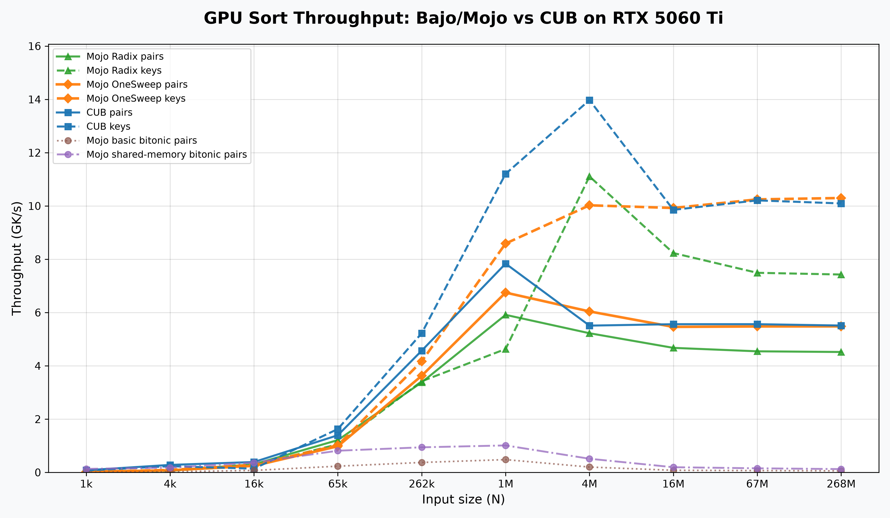

# GPU sorting

Generate the results with the [sorting benchmark](../../../bench/sort/bench_gpu_sort.mojo)
and plot them with [plot_gpu_sort.py](../../../bench/sort/plot_gpu_sort.py).

## Sources

- [Decoupled-Fallback-Paper](https://github.com/b0nes164/Decoupled-Fallback-Paper)
- [GPUSorting](https://github.com/b0nes164/GPUSorting) by b0nes164 (Thomas Smith)
- [CUDA Core Compute Libraries](https://github.com/NVIDIA/cccl?tab=License-1-ov-file#readme)
- [Onesweep](https://arxiv.org/abs/2206.01784)  paper
- [The fastest sorting algorithm](https://www.youtube.com/watch?v=Y95a-8oNqps) Nice video explaining radix sort
- mojo community
